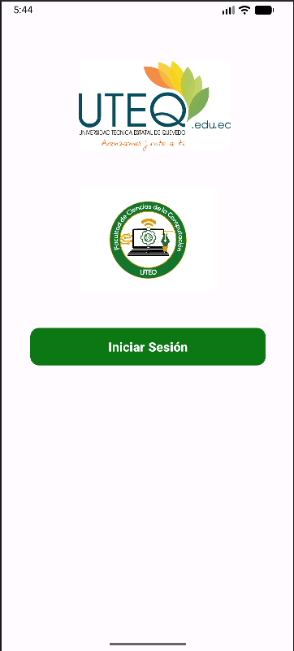
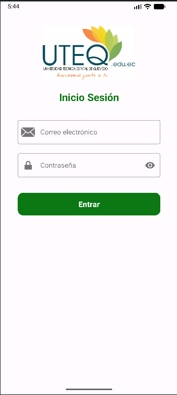

# HolaMundo_IS2026_2

Esta es una aplicación que tiene una pantalla principal de login, y una pantalla de **Inicio de Sesión**. Las dos pantallas usan `ConstraintLayout` y componentes de Material Design.

  
  &nbsp;&nbsp;&nbsp;
  

## Características

### Pantalla principal (`MainActivity`)

- **Logo de la universidad:** imagen `logo_universidad` en la parte superior.
- **Logo de la facultad:** imagen `logo_facultad_fcc` debajo del logo de la universidad.
- **Botón Iniciar Sesión:** `MaterialButton` verde que abre la pantalla de inicio de sesión.

### Pantalla de Inicio Sesión (`inicioseccion`)

La interfaz usa componentes de Material Design (`TextInputLayout` con estilo *OutlinedBox*) e incluye:

- **Logo de la universidad:** encabezado con el logo de la UTEQ.
- **Título:** texto "Inicio Sesión" en verde y negrita.
- **Correo electrónico:** campo de texto de tipo `textEmailAddress` con un ícono de sobre.
- **Contraseña:** campo de tipo `textPassword` con un ícono de candado y un botón para mostrar u ocultar la contraseña.
- **Botón Entrar:** `MaterialButton` verde con bordes redondeados.

## Detalles técnicos

- **Lenguaje:** Kotlin.
- **Diseño de interfaz:** hecho en XML (`activity_main.xml` y `activity_inicioseccion.xml`).
- **Layout principal:** `ConstraintLayout` para ubicar los elementos unos respecto de otros.
- **Navegación:** un `Intent` abre la pantalla de inicio de sesión desde la pantalla principal.
- **Diseño de borde a borde:** `enableEdgeToEdge()` con márgenes que se ajustan a las barras del sistema.
- **SDK:** `minSdk 24`, `targetSdk 37`.

## Cómo ejecutar

1. Clona el repositorio.
2. Abre el proyecto en Android Studio.
3. Sincroniza Gradle (*Sync Project with Gradle Files*).
4. Ejecuta la app en un emulador o en un dispositivo físico.
